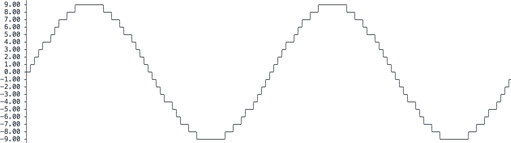

# asciichart

<p><a href="https://opensource.org/licenses/MIT"></a>
<a href="https://travis-ci.org/madnight/asciichart"></a>

</a></p>


ASCII line charts in terminal ╭┈╯. Console line charts in pure Haskell.  
This is a Haskell port of the Javascript library [kroitor/asciichart](https://github.com/kroitor/asciichart). Free for any usage (MIT License).



## Usage
```bash
cabal install asciichart
```

```haskell
import Data.Text.Chart (plot)

main :: IO ()
main = plot [1..20]
```

For more examples e.g. sinus wave see [examples folder](https://github.com/madnight/asciichart/tree/master/examples).  
You can also find this package on [Hackage](http://hackage.haskell.org/package/asciichart).

## References

Full credits to [kroitor](https://github.com/kroitor/) the inventor of asciichart for the terminal.  
This is only a simple port for the Haskell community.
